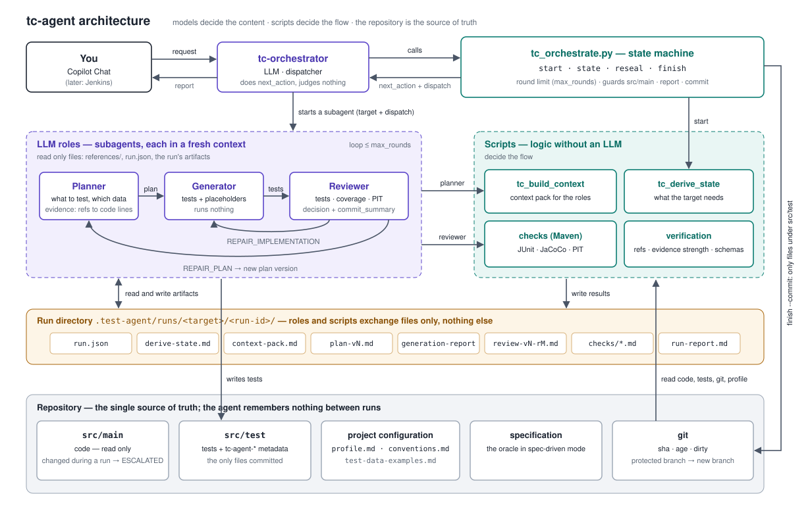

# tc-agent — AI test pipeline

tc-agent writes JUnit tests for one Java class (or method) in a Maven project.
It trusts only the committed code, the tests and git — no memory between runs.

## Agents

| agent | job |
|---|---|
| `tc-orchestrator` | the one you call. Runs the scripts and calls the other agents. |
| `tc-planner` | decides WHAT to test (scenarios, data, evidence). |
| `tc-generator` | writes the test code. Never runs anything. |
| `tc-reviewer` | runs tests, coverage and mutations; decides ACCEPT or repair. |

## Setup (once per repo)

1. Maven project with JUnit 5 or JUnit 4 — taken from what the module's tests import, from the poms only if it has none (`junit` in the profile overrides both).
2. **JaCoCo and PIT need no pom entry.** The checks call their goals by full coordinates, so an untouched pom works; a version declared in the pom is used, otherwise the agent's default. One exception: on **JUnit 5**, PIT needs `pitest-junit5-plugin` as a plugin dependency in the pom — that cannot be added from the CLI, and without it mutation testing is reported as unavailable.
3. Git, and Python 3 with `pip install -r .github/agents/tc-agent/requirements.txt`.
4. Copilot custom agents enabled; `.test-agent/` in `.gitignore` (run files live there).

## How to run

In Copilot Chat choose **tc-orchestrator** and say what you want, for example:

    Generate tests for SimpleCalculatorService, mode characterization, commit
    Generate tests for OrderService.create, mode spec-driven, spec docs/order-spec.md, interactive
    Generate tests for TransferService, data examples in docs/test-data-examples.md

The orchestrator turns this into `tc_orchestrate.py start` with these options:

| option | meaning |
|---|---|
| target | `ClassName` or `ClassName.methodName`. One or a list. |
| `--mode characterization` (default) | Freeze the CURRENT behavior, bugs included. Tests describe what the code does now. |
| `--mode spec-driven` | Tests come only from the specification's requirements — nothing the spec does not describe; the gates do not drive it. A test that fails because the code does not do what the spec says is kept disabled (`AI spec-mismatch`) and listed at the top of the report. |
| `--spec <path>` | The specification file; required in spec-driven mode (the orchestrator asks for it). |
| `--interactive` | The planner may ask questions (what to freeze, example data). Also turns off the freshness guard. |
| `--test-data <path>` | A file of example business values, used in any mode (repeatable). Say it in the prompt: "examples are in docs/test-data-examples.md". Without it, only `--interactive` makes the planner ask. |
| `--max-rounds <n>` (3) | Max generate + review rounds in the whole run; a new plan version uses up a round too. Default from the profile's `max_rounds`. |
| `--commit` | Commit the new test files at the end — see **Commit**. |

## Flow

1. **start** — derive-state checks the target: git state, tests, JaCoCo, PIT (spec-driven: tests only). Verdict:
   - `DONE` — tests exist, green, gates met, code unchanged → nothing to do (characterization);
   - `PLAN` — something is missing (no tests, coverage/mutation gap, untested or changed methods, stale tests; spec-driven: always);
   - `RED` — existing tests fail → a human must look;
   - `BLOCKED` — characterization only: target has uncommitted changes, is not committed, or is too fresh;
   - `ESCALATE` — the target cannot be resolved or a check could not run.
2. **RESEAL** — still-green stale tests get the new sha after a code change.
3. **PLAN → GENERATE → REVIEW**, repeated until the reviewer accepts or `max_rounds` review rounds are
   spent. The reviewer's decision picks the next step: repair the tests, repair the plan, or accept.
4. **FINISH** — writes `run-report.md`, prints it, and commits if `--commit` was given.

Outcomes: `DONE`, `DONE_PARTIAL` (placeholders left), `BLOCKED`, `RED`, `ESCALATED` (round limit, a human decision, or a file outside `src/test` changed during the run).

## Configuration

Per-repository settings live in the **project directory** `.github/agents/tc-agent-project/`,
never inside this package. All files are optional; all keys: `docs/configuration.md`.

- **`profile.md`** (json block, checked against its schema at `start`): gates, rounds, freshness,
  protected branches, test data, maven. Every key is optional — the table of keys and defaults
  is at the top of `docs/configuration.md`.
- **`conventions.md`** — this repo's test style; read first among the style rules.
- **`test-data-examples.md`** — example business values; always in the context pack.
- **Other style rules** — `.github/copilot-instructions.md`, `.github/instructions/*.instructions.md`
  (by `applyTo`) and `AGENTS.md`. Repo rules override the default style in
  `references/conventions.md` §B, never §A.

Default style: `shouldXxxWhenYyy`, `// given / // when / // then`, AssertJ, Mockito for repositories, class under test as a field, class `<Target>Test`.

## Commit (`--commit`)

- Only on `DONE` or `DONE_PARTIAL`, and only the files under `src/test` this run wrote.
- On a protected branch it first creates a new branch `tc-agent/<target>/<run-id>`.
- Message: title `[TC-AGENT] Add tests for <target>.`, a 2–5 sentence summary of the whole run
  (written by the reviewer), then facts (mode, target sha, counts, gates, suggestions) — nothing from `.test-agent/`.
- Never pushes.

## What you get

Every run has its own folder `.test-agent/runs/<target>/<run-id>/`:
`run.json`, `derive-state.md`, `context-pack.md`, `plan-vN.md`,
`generation-report-vN[-rM].md`, `review-vN-rM.md`, `checks/`, `run-report.md`. Old runs are never read again and never deleted.
Agent's own files: role prompts, this README and `requirements.txt` at the top; what the roles read under `references/` (`contracts.md`, `conventions.md`, `junit4.md`, `modes/*.md` — each role gets the list that applies to the run in `dispatch.references`); plus `schemas/`, `scripts/`, and `docs/` for people.
Each generated test method has a Javadoc with plain-text metadata:

    tc-agent-mode: characterization, interactive: false
    tc-agent-characterizes: SimpleCalculatorService@29aeef6a

(spec-driven tests carry `tc-agent-spec: <spec file>#<requirement>` instead of `tc-agent-characterizes`.)

A scenario that cannot be tested (e.g. code reads `LocalDateTime.now()`) becomes an empty
`@Disabled("AI deferred: …")` method with `tc-agent-deferred: <reason>`. Do not delete
placeholders — they tell the next run the gap is known.

## Good to know

- Only the scripts run Maven; the agents never do; to start again, just run again.
- In PowerShell, quote `-D` args: `mvn "-Dtest=FooTest"`.
