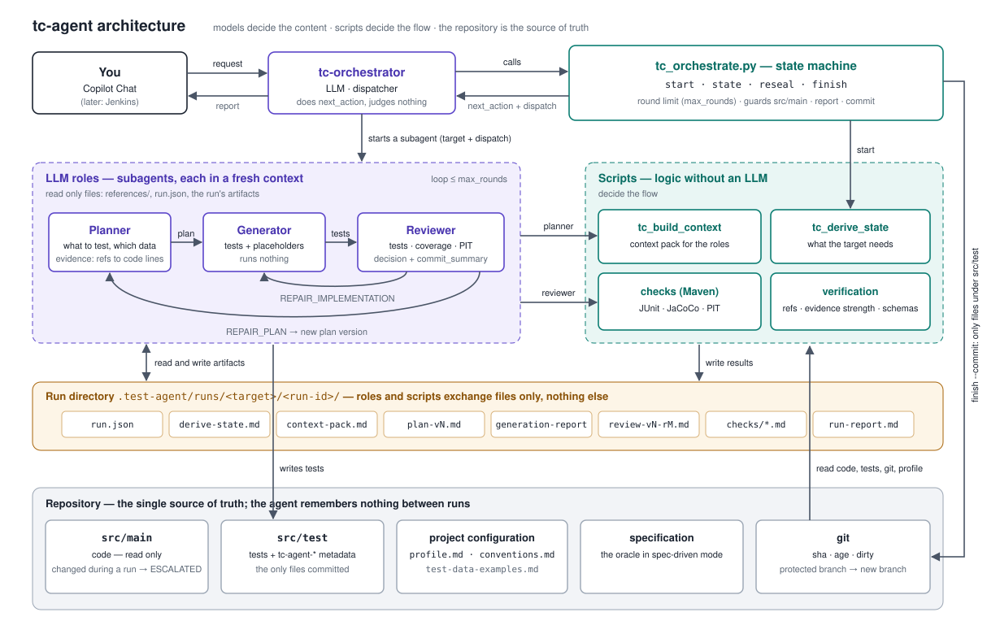

# tc-agent — specyfikacja (stan obecny)

> Opisuje agenta takim, jaki jest teraz (gałąź `model-b3`). Historia decyzji: `docs/MODEL-B-PLAN.md`
> (D1–D68) i `docs/MODEL-B2-PLAN.md` (D69–D83). Instrukcja dla użytkownika: `.github/agents/tc-agent/README.md`.

## 1. Zasada

**Prawda = zacommitowany kod + testy + historia git.** Między przebiegami agent niczego nie pamięta:
każdy przebieg wyprowadza stan od nowa (`derive-state`). Wewnątrz przebiegu role wymieniają się plikami
w `.test-agent/runs/<slug>/<run-id>/` (gitignored); żaden skrypt nie czyta katalogu innego przebiegu.

## 2. Układ

| co | gdzie | czyje |
|---|---|---|
| prompty ról, `references/`, schematy, skrypty, dev-testy, `docs/` | `.github/agents/tc-agent/` | wspólne (w przyszłości submodule) |
| `profile.md`, `conventions.md`, `test-data.md` (wszystkie opcjonalne) | `.github/agents/tc-agent-project/` | projektu |
| przebiegi, cache `env.json` | `.test-agent/` | lokalne |

`references/`: `contracts.md`, `conventions.md` (§A integralność, §B domyślny styl), `junit4.md`,
`modes/characterization.md`, `modes/spec-driven.md`, `modes/interactive.md`. Każda rola czyta tylko
pliki z `dispatch.references`, wyliczone przez skrypt: zawsze contracts + conventions, `junit4.md` w module
na JUnit 4, plik trybu, a planer w przebiegu interactive także `interactive.md`. Każda reguła ma jednego
właściciela; prompt ról tylko się do niej odwołuje.

Pierwszeństwo reguł: integralność (contracts, conventions §A, junit4, pliki trybów) > instrukcje repo
(REPO CONVENTIONS w packu: `conventions.md` projektu, `copilot-instructions.md`, `*.instructions.md`
po `applyTo`, `AGENTS.md`, `instruction_paths`) > domyślne §B.

## 3. Tryby

| | wyrocznia | metadane | gdy test pada |
|---|---|---|---|
| `characterization` (domyślny) | obecny kod, błędy włącznie | `tc-agent-characterizes: <Class>@<sha>` | naprawa testu (albo planu) |
| `spec-driven` | specyfikacja `--spec` (wymagana; sekcja SPEC w packu), tylko jej wymagania — nic, czego spec nie opisuje | `tc-agent-spec: <plik>#<wymaganie>` | rozbieżność: test zostaje wyłączony `AI spec-mismatch` z ciałem, raport ją wymienia |

`--interactive` to modyfikator obu trybów: planer pyta człowieka (najpierw o dane, potem o to, co zamrozić
albo jak rozumieć wymaganie) i zapisuje pytania także jako `CONFIRM:`. W characterization zdejmuje
blokadę świeżego kodu.

## 4. Metadane w kodzie

Javadoc nad METODĄ testu (nigdy nad klasą), linie `tc-agent-<klucz>: <wartość>`:

| linia | kiedy |
|---|---|
| `tc-agent-mode: <characterization\|spec-driven>, interactive: <true\|false>` | zawsze — marker testu agenta |
| `tc-agent-characterizes: <Class>@<sha>` | characterization |
| `tc-agent-spec: <plik spec>#<wymaganie>` | spec-driven |
| `tc-agent-deferred: <powód>` | placeholder: pusta metoda `@Disabled("AI deferred: …")` (`@Ignore` w JUnit 4) |
| `tc-agent-note: <tekst>` | fakt o tym teście (znany błąd, odpowiedź człowieka, spec mismatch) |

Inny klucz `tc-agent…:` = defekt metadanych. Każdy scenariusz planu kończy w kodzie jako test albo
placeholder. Scenariusz ↔ test łączy nazwa metody; id scenariusza nigdy nie trafia do kodu.

## 5. derive-state

Warstwy od najtańszej: target → testy i Javadoc + git → testy i pokrycie (JaCoCo) → mutacje (PIT).
Wynik `next_action`:

| wynik | kiedy |
|---|---|
| `PLAN` | `NO_TESTS`, `COVERAGE_GAP`, `MUTATION_GAP`, `UNTESTED_METHODS`, `CHANGED_CODE_UNCOVERED`, `STALE`; w spec-driven zawsze `SPEC_REVIEW` (tylko testy, bez JaCoCo i PIT) |
| `DONE` | bramki spełnione na bieżącym kodzie (tylko characterization) |
| `RED` | czerwony test spoza zakresu naprawy (w spec-driven każdy, także stale) albo błąd kompilacji |
| `BLOCKED` | characterization: target zmieniony (treść, nie końcówki linii) albo niezacommitowany — zawsze, przed mavenem; młodszy niż `freshness_days` bez interactive — gdy jest co planować |
| `ESCALATE` | target nie istnieje / niejednoznaczny, brak gita, check nie mógł się wykonać |

Stale test characterization, który nadal przechodzi, dostaje mechanicznie nowy sha (`reseal`); czerwony
wraca do planera (w trybie characterization).

## 6. Przebieg

`tc_orchestrate.py`: `start` (jedyne miejsce na tryb, interactive, spec, `--test-data`, `--max-rounds`,
`--commit`) → `state` (`PLAN | GENERATE | REVIEW | RESEAL | WAIT | FINISH`) → `finish` (raport, opcjonalny commit).
Orchestrator wykonuje tylko `next_action`. Pętla PLAN → GENERATE → REVIEW ma limit `max_rounds` (domyślnie 3)
rund w całym przebiegu; runda = generacja + review, nowa wersja planu też ją zużywa. O naprawie testu albo
planu decyduje recenzent; po limicie przebieg kończy się `ESCALATED`, testy zostają w drzewie.

Outcome: `DONE`, `DONE_PARTIAL` (placeholdery albo rozbieżności spec), `BLOCKED`, `RED`, `ESCALATED`.
`--commit`: tylko przy DONE/DONE_PARTIAL, tylko pliki przebiegu spod `src/test`, nigdy na branchu z
`protected_branches` (domyślnie `master`, `main`; wtedy nowy `tc-agent/<slug>/<run-id>`), bez push.
Zmiana poza `src/test` (i poza `.test-agent/`, `target/`) w trakcie przebiegu → `ESCALATED` bez commita.
Plan v2+ ze statusem `COMPLETE` → `ESCALATED`. Plan v(N+1) po `REPAIR_PLAN` zawiera tylko zmiany; jego
pierwsza generacja nie dostaje review.

## 7. Dane biznesowe

LLM nie jest źródłem prawdy o danych (`conventions.md` §A4). Kolejność źródeł: TEST DATA (pliki
wskazane przez człowieka, w tym `test-data.md` projektu) → odpowiedzi z tego przebiegu → DATA EXAMPLES
(linie z całego drzewa testów i zasobów testowych, które ustawiają pola używane przez target) i testy w
packu → buildery, fixture'y, seedery, ograniczenia walidacji → człowiek (interactive) → odroczenie.
Kształt wartości dotyczy też wartości relacyjnych; neutralny literał (`"KEY-1"`) tylko dla pola bez
znanego kształtu; identyfikatory z sumą kontrolną tylko kopiowane.

## 8. Role

| rola | robi | nie robi |
|---|---|---|
| orchestrator | uruchamia skrypty, wywołuje role, pokazuje raport `finish` dosłownie | nie ocenia, nie edytuje plików |
| planner | zakres z derive-state, dowody, scenariusze, `evidence_strength` (skrypt), plan | nie pisze kodu |
| generator | testy i placeholdery wg planu, naprawy w zadanym `scope` | nie uruchamia niczego (poza `get_errors`), nie dotyka `src/main` |
| reviewer | testy, pokrycie, mutacje, zgodność z §A, jakość, atrybucja, decyzja, `commit_summary` | nie edytuje kodu ani planu |

Bramki (`branch_coverage_target_scope`, `mutation_score_target_scope`) są poprzeczką: spełniona bramka nie
prowadzi do naprawy.

## 9. Dev-testy

Bez Mavena (`tools/fake_mvn`): `tc_test_javadoc.py`, `tc_test_derive_state.py`, `tc_test_run_state.py`,
`tc_test_build_context.py`, `tc_test_check_scripts.py`, `tc_check_examples.py`. Z prawdziwym Mavenem:
`tc_smoke_pipeline.py`. `tc_test_run_state.py` pilnuje też list `dispatch.references` i zasady
„jeden właściciel reguły”.

## 10. Otwarte

- Pomiar E20/E21 (czy przy DATA EXAMPLES pojawiają się literały typu `CUSTOMER-1`) decyduje o `tc_check_data`.
- Listy `tools` ról (etap 8 planu B2) — po weryfikacji w Copilocie.
- Po B2: dystrybucja pakietu, walidacja na realnych repo, testy warstw Spring (`MODEL-B2-PLAN.md` §6).
