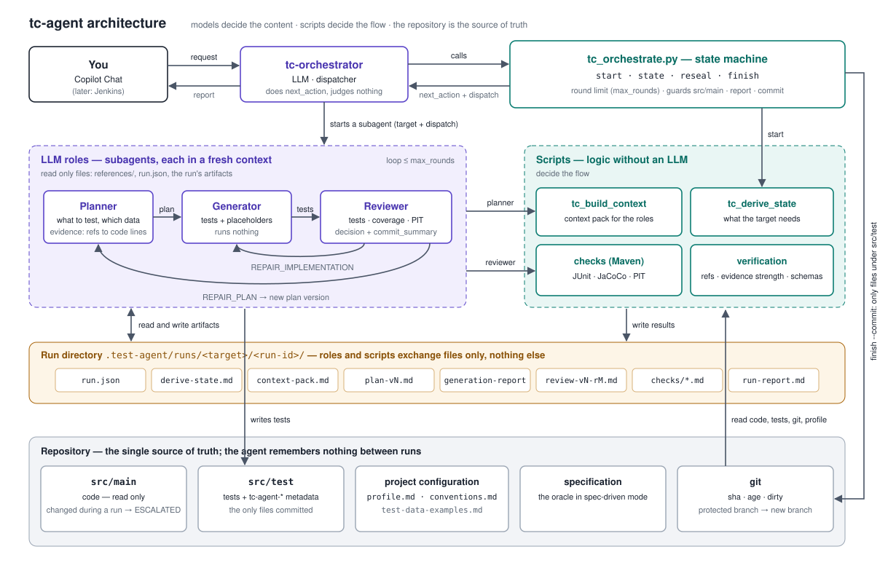

# tc-agent — przewodnik (do prezentacji)

Stan: gałąź `model-b2`, październik 2026. Szczegóły techniczne: `docs/MODEL-B-SPEC.md`,
historia decyzji: `docs/MODEL-B-PLAN.md`, `docs/MODEL-B2-PLAN.md`.

---

## 1. W jednym akapicie

tc-agent to zestaw agentów Copilota, który pisze testy JUnit dla jednej klasy (albo metody) w projekcie
Java / Spring Boot / Maven. **Decyzje „co dalej” podejmują deterministyczne skrypty Pythona, a LLM robi
tylko to, w czym jest dobry:** planuje scenariusze, pisze kod testu i ocenia jego jakość. Między
przebiegami agent nic nie pamięta — **prawdą jest zacommitowany kod, testy i historia gita**, a metadane
każdego wygenerowanego testu siedzą w jego Javadocu.



*Role LLM (fioletowe) decydują o treści, skrypty (zielone) o przebiegu; wymieniają się tylko plikami w katalogu przebiegu, a commit obejmuje wyłącznie `src/test`.*

## 2. Co umie

| możliwość | jak |
|---|---|
| **Tryb `characterization`** (domyślny) | zamraża obecne zachowanie kodu, błędy włącznie; moment zamrożenia to ostatni commit testu (git) |
| **Tryb `spec-driven`** | testy wg specyfikacji (`--spec`); jeśli kod robi co innego niż spec — test zostaje wyłączony z ciałem i ląduje na górze raportu jako rozbieżność |
| **Modyfikator `interactive`** | planer pyta człowieka (najpierw o przykładowe dane, potem co zamrozić / jak rozumieć wymaganie) |
| **Dane biznesowe z repo** | `test-data-examples.md` projektu, `--test-data`, sekcja DATA EXAMPLES (jak inne testy w CAŁYM repo wypełniają te same pola — np. `customerId` = 9 cyfr) — nie `CUSTOMER-1` |
| **Bramki jakości** | branch coverage (JaCoCo) i mutation score (PIT) — domyślnie 80% / 70%, w profilu projektu |
| **Limit 3 rund** | generacja + review najwyżej 3 razy na przebieg; potem `ESCALATED`, testy zostają w drzewie |
| **Zaślepki** | scenariusz nietestowalny (np. `LocalDateTime.now()` bez `Clock`) → pusta metoda `@Disabled("AI deferred: …")` + sugestia zmiany w kodzie |
| **Zmiana kodu** | test, który po zmianie nadal przechodzi, zostaje bez zmian; czerwony wraca do planera |
| **Commit (`--commit`)** | tylko pliki testowe przebiegu, tylko przy DONE / DONE_PARTIAL; na chronionym branchu tworzy `tc-agent/<cel>/<run-id>`; nigdy push |
| **Ochrona kodu produkcyjnego** | zmiana w `src/main` w trakcie przebiegu → `ESCALATED`, bez commita |
| **Wielomodułowość, JUnit 4 i 5** | moduł z najbliższego `pom.xml`, `-pl <moduł>`; wersja JUnit z importów istniejących testów |
| **JaCoCo i PIT bez zmian w pomie** | wołane po pełnych koordynatach z CLI (wyjątek: PIT na JUnit 5 wymaga `pitest-junit5-plugin` w pomie) |
| **Szybki build** | gdy `target/classes` aktualne: bez kompilacji `src/main` i bez fazy `test` (same gole: `testResources testCompile surefire:test`) — bez generatorów i frontu |

**Czego nie robi (świadomie):** Gradle; testów `@WebMvcTest` / `@DataJpaTest` / integracyjnych (jest test
jednostkowy jednej klasy z zamockowanymi repozytoriami); zmian w kodzie produkcyjnym; push.

## 3. Jak uruchomić

W Copilot Chat agent **tc-orchestrator**:

    Generate tests for SimpleCalculatorService, mode characterization, commit
    Generate tests for OrderService.create, mode spec-driven, spec docs/order-spec.md, interactive
    Generate tests for TransferService, data examples in docs/test-data-examples.md

Opcje (orchestrator przekłada je na `tc_orchestrate.py start`): `--mode characterization|spec-driven`,
`--interactive`, `--spec <plik>`, `--test-data <plik>`, `--max-rounds <n>`, `--commit`.

## 4. Przebieg

```
start ── derive-state (git, testy, JaCoCo, PIT) ──┬─ DONE / RED / BLOCKED / ESCALATE ──► FINISH
                                                  └─ PLAN
                                                      │
                     ┌────────────── runda (≤ 3) ─────┴──────────────┐
                     │ tc-planner → tc-generator → tc-reviewer        │
                     │   decyzja: ACCEPT / ACCEPT_PARTIAL             │──► FINISH (raport, commit)
                     │            REPAIR_IMPLEMENTATION → generator   │
                     │            REPAIR_PLAN → planner               │
                     │            NEEDS_TRIAGE / BLOCKED → człowiek   │
                     └────────────────────────────────────────────────┘
```

| wynik | znaczenie |
|---|---|
| `DONE` | bramki spełnione, testy zielone |
| `DONE_PARTIAL` | jak wyżej, ale zostały zaślepki albo rozbieżności ze spec |
| `BLOCKED` | target ma niezacommitowane zmiany / nie jest zacommitowany / za świeży (characterization bez interactive) |
| `RED` | istniejące testy są czerwone albo się nie kompilują — najpierw człowiek |
| `ESCALATED` | limit rund, decyzja dla człowieka albo zmiana kodu produkcyjnego w trakcie |

**Kto co decyduje:** `tc_orchestrate.py state` mówi orchestratorowi, co dalej (`next_action`);
orchestrator tylko wykonuje. O naprawie testu vs planu decyduje recenzent. Bramki liczą skrypty.

---

## 5. Pliki w repo — co który znaczy

### 5.1 `.github/agents/tc-agent/` — pakiet wspólny (ten sam w każdym repo)

**Agenci (prompty ról)**

| plik | rola |
|---|---|
| `tc-orchestrator.agent.md` | ten, którego wołasz. Uruchamia skrypty, przekazuje pracę rolom, pokazuje raport. Nie ocenia, nie edytuje |
| `tc-planner.agent.md` | decyduje CO testować i jakimi danymi; zbiera dowody (refy do linii kodu); pisze plan. Nie pisze kodu |
| `tc-generator.agent.md` | pisze testy i zaślepki wg planu; w rundach naprawczych poprawia tylko wskazany zakres. Niczego nie uruchamia |
| `tc-reviewer.agent.md` | uruchamia testy, pokrycie, mutacje; sprawdza zgodność z regułami i jakość asercji; decyduje; pisze opis commita |
| `README.md` | instrukcja dla użytkownika |
| `requirements.txt` | jedyna zależność Pythona: `jsonschema` |

**`references/` — reguły, które czytają role** (każda rola dostaje w `dispatch.references` tylko pliki
dotyczące jej przebiegu; każda reguła ma jednego właściciela)

| plik | zawartość | kto czyta |
|---|---|---|
| `contracts.md` | wspólne zasady: skąd prawda, format artefaktów, rundy, metadane, context pack, skrypty jako czarne skrzynki, kolejność ważności reguł | wszyscy |
| `conventions.md` | §A — integralność (nienadpisywalna): metadane, zaślepki, dane biznesowe, determinizm, granice; §B — domyślny styl (nazwy `shouldXWhenY`, `// given / when / then`, AssertJ, Mockito…) | planer, generator, recenzent |
| `junit4.md` | różnice dla modułu na JUnit 4 (`@Ignore`, brak `@DisplayName`, wyjątki bez AssertJ) | tylko w module JUnit 4 |
| `modes/characterization.md` | co znaczy tryb, stale testy, przykład planu; sekcje per rola | tryb characterization |
| `modes/spec-driven.md` | spec jako wyrocznia, `SPEC_REVIEW`, obsługa rozbieżności | tryb spec-driven |
| `modes/interactive.md` | jak i o co pytać człowieka (dane, zamrożenie, wymagania) | planer w trybie interactive |

**`schemas/` — kontrakty JSON (walidowane skryptem, nie „na oko”)**

| plik | waliduje |
|---|---|
| `tc-test-plan.schema.json` | plan planera (scenariusze, dowody, `deferred`, status) |
| `tc-generation-report.schema.json` | raport generatora (co zaimplementowano, zaślepki, sugestie) |
| `tc-review.schema.json` | review recenzenta (checki, findingi, decyzja, `commit_summary`) |
| `tc-project-profile.schema.json` | `profile.md` projektu |

**`scripts/` — logika (deterministyczna, bez LLM)**

| plik | co robi |
|---|---|
| `tc_orchestrate.py` | serce przebiegu: `start` / `state` / `finish`; maszyna stanów, limit rund, lista references dla ról, ochrona `src/main`, raport, commit |
| `tc_derive_state.py` | na starcie liczy, czego target potrzebuje: git (dirty, wiek, sha), metadane testów, potem testy + pokrycie, potem mutacje → `PLAN / DONE / RED / BLOCKED / ESCALATE` |
| `tc_build_context.py` | składa `context-pack.md` dla planera i generatora (kod targetu z numerami linii, testy, buildery, zależności, dane, konwencje repo, spec) |
| `tc_run_tests.py` | jedyny skrypt budujący: uruchamia testy targetu z agentem JaCoCo i od razu generuje raport pokrycia |
| `tc_coverage.py` | czyta pokrycie gałęzi dla targetu, porównuje z bramką, wypisuje niepokryte linie |
| `tc_mutation.py` | uruchamia PIT tylko na targecie, wypisuje przeżywające mutanty, porównuje z bramką |
| `tc_javadoc.py` | parser metadanych `tc-agent-*` w Javadocu testów |
| `tc_git.py` | fakty z gita: sha, dirty (bez końcówek linii), wiek commita, zmienione linie, migawka `src/main` |
| `tc_common.py` | wspólne: znajdowanie targetu i modułu, profil projektu, wywołania mavena, wersja JUnit, JaCoCo/PIT |
| `tc_evidence_strength.py` | klasyfikuje siłę dowodów scenariusza (strong / medium / weak) — LLM tego nie szacuje |
| `tc_verify_refs.py` | sprawdza, że każdy ref w planie wskazuje istniejące linie i że nazwy metod nie kolidują |
| `tc_validate_plan.py` | waliduje artefakt (plan, raport, review) jego schematem JSON |
| `tc_md_payload.py` | czyta/zapisuje jedyny blok ```json w artefakcie `.md` |

**`docs/configuration.md`** — opis wszystkich kluczy `profile.md` (dla ludzi).

### 5.2 `.github/agents/tc-agent-project/` — konfiguracja tego repo

| plik | zawartość |
|---|---|
| `profile.md` | blok JSON: bramki, `freshness_days`, `max_rounds`, `protected_branches`, opcje mavena, wersja JUnit |
| `conventions.md` (opcjonalny) | styl testów tego repo — nadpisuje §B, nigdy §A |
| `test-data-examples.md` (opcjonalny) | przykładowe wartości biznesowe („customer id = 9 cyfr, np. 123456789”) |
| `README.md` | co to za katalog |

### 5.3 Pozostałe

| plik | znaczenie |
|---|---|
| `AGENTS.md` | notka dla ludzi: jak czytać wygenerowane testy |
| `docs/MODEL-B-SPEC.md` | specyfikacja stanu obecnego |
| `docs/MODEL-B-PLAN.md`, `docs/MODEL-B2-PLAN.md` | dziennik decyzji i planów |

---

## 6. Metadane w testach (to jest „baza danych” agenta)

```java
/**
 * AI-generated test. Characterizes current behavior of OrderService (a freeze, not a spec).
 * tc-agent-mode: characterization, interactive: false
 * tc-agent-note: human-confirmed: zero fee is rejected
 */
```

| linia | znaczenie |
|---|---|
| `tc-agent-mode` | metodę napisał agent; tryb i czy był człowiek |
| `tc-agent-deferred` | zaślepka: dlaczego scenariusz nie jest testowany |
| `tc-agent-note` | fakt o teście: znany błąd, odpowiedź człowieka, rozbieżność ze spec |

Co test zamroził, mówi git: to kod z chwili ostatniego commitu tej metody testowej.

Kolega, który sklonuje repo, albo Jenkins dostaną z `start` ten sam wynik — wszystko jest w kodzie i gicie.

---

## 7. Pliki robocze w `.test-agent/` (gitignored)

```
.test-agent/
  env.json                              cache: czy pom sam podpina agenta JaCoCo (per moduł)
  runs/<Klasa>/<run-id>/                jeden katalog na przebieg, np. 20261008-080239
    run.json
    derive-state.md
    context-pack.md
    plan-v1.md [plan-v2.md]
    generation-report-v1.md [-r2, -r3]
    review-v1-r1.md [...]
    run-report.md
    checks/
```

Każdy artefakt `.md` = tytuł + krótkie streszczenie + **jeden blok JSON** (to on jest kontraktem).
Żaden skrypt nie czyta katalogu innego przebiegu; stare przebiegi zostają do wglądu.

| plik | kto pisze | co jest w środku | kto czyta |
|---|---|---|---|
| `run.json` | `start` | tryb, interactive, spec, `max_rounds`, `--commit`, pliki test-data, migawka `src/main`, na końcu wynik i commit | wszystkie skrypty i role |
| `derive-state.md` | `tc_derive_state.py` | target (plik, moduł, FQCN), git (sha, dirty, wiek), kontrakt repo (JUnit, JaCoCo/PIT), testy (AI / ludzkie / zaślepki / defekty metadanych), stale / red, pokrycie (w tym metody bez pokrycia i zmienione od zamrożenia, a niepokryte linie) i mutacje, `next_action` i powody (`NO_TESTS`, `COVERAGE_GAP`, `STALE`, `SPEC_REVIEW`…) | `state`, planer |
| `context-pack.md` | `tc_build_context.py` (woła planer) | TEST FRAMEWORK, TEST DATA, DATA EXAMPLES, REPO CONVENTIONS, SPEC, kod targetu, istniejące testy, buildery, enumy, zależności (z numerami linii pliku), typy z jarów, manifest | planer, generator, recenzent |
| `plan-vN.md` | tc-planner | scenariusze (opis, dane, dowody `plik:linie`, siła dowodów, nazwa metody, plik testu), `deferred` z powodem, `obsolete`, notatki `CONFIRM:` dla człowieka, status planu | generator, recenzent |
| `generation-report-vN[-rM].md` | tc-generator | które scenariusze są testem, które zaślepką (z powodem), zmienione pliki testowe, sugestie zmian w kodzie | recenzent, `finish` (lista plików do commita) |
| `review-vN-rM.md` | tc-reviewer | wyniki checków (testy, pokrycie, mutacje), findingi z przypisaniem winy (plan / implementacja), feedback dla generatora, decyzja, `commit_summary` | `state` (co dalej), generator / planer (naprawa), `finish` |
| `run-report.md` | `finish` | wynik i powód, czerwone testy i rozbieżności ze spec na górze, historia rund, co zmieniono, zaślepki, sugestie, pytania do człowieka, bramki, czas mavena, commit, następne kroki | człowiek (orchestrator pokazuje go dosłownie) |

**`checks/`** — wyniki skryptów; `<label>` = `entry` (pomiar na starcie) albo `v1-r2` (runda review):

| plik | zawartość |
|---|---|
| `tests-<label>.md` | wyniki testów: liczby, porażki z fazą (setup / assertion), flaky, błędy kompilacji, użyta ścieżka mavena, czas |
| `coverage-<label>.md` | pokrycie gałęzi targetu (albo metody) vs bramka, niepokryte linie z liczbą pominiętych gałęzi |
| `mutation-<label>.md` | mutation score vs bramka, przeżywające mutanty z liniami |
| `jacoco-<label>.exec` | surowe dane JaCoCo z tego pomiaru |
| `maven-<check>-<label>.log` | log mavena (pisany na żywo; po zielonym checku przycięty do końcówki) |

## 8. Co trafia do gita

- testy (z metadanymi w Javadocu) — przy `--commit` automatycznie, bez tego zostają w drzewie do przejrzenia;
- opis commita: tytuł `[TC-AGENT] Add tests for <Klasa>.`, 2–5 zdań od recenzenta, fakty (tryb + sha, liczby testów, bramki, sugestie) — nic z `.test-agent/`;
- nigdy: kod produkcyjny, `.test-agent/`, push.

## 9. Ściąga na pytania z sali

| pytanie | odpowiedź |
|---|---|
| Czy LLM wymyśla dane? | Nie: wartości tożsamościowe biorą kształt z test-data, z innych testów w repo albo od człowieka; granice i stałe — z linii kodu; brak źródła = zaślepka z pytaniem |
| Kto decyduje, czy test jest dobry? | Recenzent w osobnym kontekście + twarde liczby: testy, JaCoCo, PIT, walidacja schematów |
| Czy może popsuć kod produkcyjny? | Nie zapisze go w commicie, a zmiana `src/main` w trakcie zatrzymuje przebieg |
| Co jeśli test pada? | characterization: naprawa testu (max 3 rundy); spec-driven: rozbieżność → test wyłączony i zgłoszony; cudzy czerwony test → człowiek |
| Co po zmianie kodu? | stale test, który przechodzi → nic; który pada → planer go przepisuje |
| Czy to działa w CI? | tak: brak pamięci między przebiegami, `--commit` tworzy branch, push robi Jenkins |
| Ile to kosztuje? | najwyżej 3 rundy; build bez kompilacji `src/main` i bez generatorów, gdy `target/` aktualny |
| Jak dostosować do repo? | `profile.md` (bramki, maven), `conventions.md` (styl), `test-data-examples.md` (dane) — bez zmian w pakiecie |
